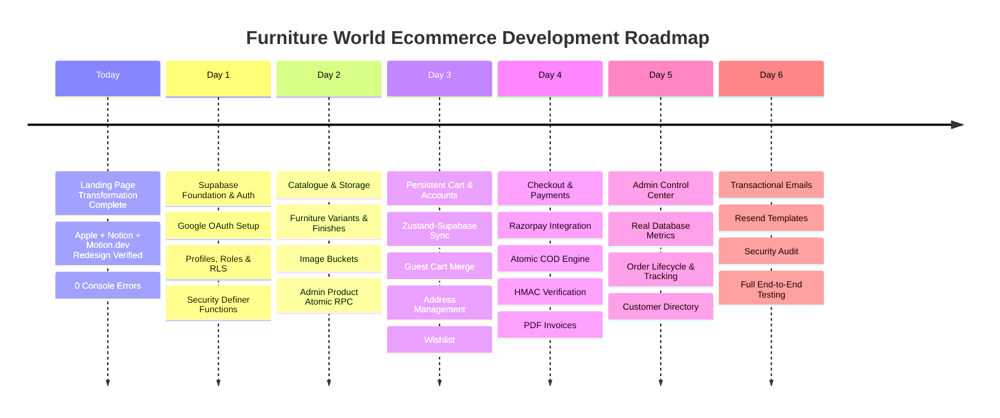

# Furniture World — Backend Development & Ecommerce Roadmap
## Complete Backend Architecture & Implementation Plan (LexCC Functional Parity)

**Project:** `PATILPARTH1500/9_FURNITURE_WORLD`  
**Reference Model:** `PATILPARTH1500/8_LEXCC`  
**Branch:** `master`  
**Status:** Architecture Blueprint & Phase Sequencing  
**Execution Timing:**  
- **Today:** Complete Landing Page Redesign (Complete & Verified)  
- **Tomorrow (Day 1):** Supabase Foundation, Auth, Google OAuth, Roles & RLS  
- **Day 2:** Product Catalogue & Storage  
- **Day 3:** Persistent Cart, Wishlist & Account  
- **Day 4:** Checkout, Razorpay & COD  
- **Day 5:** Admin Dashboard & Orders  
- **Day 6:** Notifications, Security & E2E Testing  

---

## 1. Roadmap Architecture & Goals

Furniture World is evolving from a visual showroom into a full-scale, production-ready ecommerce platform. By adopting the battle-tested architectural workflows of **LexCC** while preserving Furniture World's distinct luxury furniture identity and existing 5-scene cinematic tour, the platform will offer:

1. **Enterprise Authentication:** Email/password credentials + Google OAuth, session persistence, customer profiles, and server-side role-based access control (`customer`, `admin`, `concierge`).
2. **Robust Furniture Catalogue:** Comprehensive categories, curated collections, timber and upholstery variants, dimension specs, and multi-image galleries hosted on Supabase Storage.
3. **Persistent Cart & Wishlist:** Seamless bridge between Furniture World's high-performance Zustand cart and Supabase database carts, with guest-to-user merge on login.
4. **Hardened Indian Ecommerce Checkout:** Dual checkout pathways supporting **Razorpay** (UPI, NetBanking, Cards) and **Atomic Cash on Delivery (COD)**, backed by server-side price calculation and database row-locking against stock overselling.
5. **Administrative Power:** Dedicated admin panel for system analytics, product authoring with atomic ACID transactions, order dispatch tracking, customer lifetime metrics, and automated PDF invoice downloads.



---

## 2. Phase-by-Phase Implementation Specifications

### Phase 1 (Day 1) — Supabase Foundation, Authentication & Roles

#### Objectives
Establish the Supabase backend infrastructure, apply and extend database migrations, configure authentication (including Google OAuth), set up customer profiles, and enforce Row Level Security.

#### Action Items
1. **Schema Reconciliation & Migration:**
   - Audit `supabase/migrations/20240101000000_initial_schema.sql` in Furniture World.
   - Enhance `public.profiles` table:
     - Add `first_name`, `last_name`, `avatar_url`, `phone`.
     - Standardize `role TEXT NOT NULL DEFAULT 'customer' CHECK (role IN ('customer', 'admin', 'concierge'))`.
   - Create `public.is_admin()` helper function:
     ```sql
     CREATE OR REPLACE FUNCTION public.is_admin()
     RETURNS BOOLEAN AS $$
     BEGIN
       RETURN EXISTS (
         SELECT 1 FROM public.profiles
         WHERE id = auth.uid() AND role = 'admin'
       );
     END;
     $$ LANGUAGE plpgsql SECURITY DEFINER;
     ```
   - Create PostgreSQL trigger on `auth.users` to automatically create a row in `public.profiles` upon signup or OAuth callback.
2. **Customer Registration & Login UI:**
   - Implement `/login`, `/register`, `/forgot-password`, `/reset-password` routes styled in Furniture World's warm cream/ivory design system.
   - Form validation via React Hook Form + Zod.
3. **Google OAuth Integration (New implementation):**
   - Configure Google Cloud OAuth Client ID & Secret.
   - Set Authorized Redirect URI: `https://<supabase-project-id>.supabase.co/auth/v1/callback`.
   - Implement `supabase.auth.signInWithOAuth({ provider: 'google', options: { redirectTo: ... } })`.
   - Handle OAuth callback and automatic profile creation.
4. **Role-Based Access Control:**
   - Implement client-side `AdminRoute` and `ProtectedRoute`.
   - Enforce server-side RLS policies preventing non-admins from mutating catalogue or viewing other users' orders.

---

### Phase 2 (Day 2) — Product Catalogue, Variants & Storage

#### Objectives
Connect the live storefront to Supabase database tables, support multi-image uploads, and implement atomic product authoring.

#### Action Items
1. **Furniture Catalogue Migration:**
   - Migrate current static catalog items (`src/data/catalog.ts`) into `categories`, `products`, and `product_variants` tables.
   - Adapt variants for furniture finishes:
     - `sku`, `finish_name`, `wood_finish_id`, `fabric_finish_id`, `price`, `stock`, `dimensions_json`.
2. **Supabase Storage Buckets:**
   - Configure public buckets `product-images` and `avatars`.
   - Implement RLS: public read, authenticated admin write (`products/{productId}/{filename}`).
3. **Atomic Product Authoring RPC:**
   - Port LexCC's `save_admin_product_atomic` to Furniture World.
   - Handles product creation/updating, variant synchronization, and image gallery ordering in a single PostgreSQL transaction.

---

### Phase 3 (Day 3) — Persistent Cart, Wishlist & Customer Account

#### Objectives
Upgrade Furniture World's local Zustand cart to a persistent hybrid store, add wishlist capabilities, and build account management pages.

#### Action Items
1. **Zustand + Supabase Cart Synchronization:**
   - Keep `useCartStore` for instant UI feedback and cart drawer animations.
   - Add Supabase synchronization middleware:
     - When unauthenticated: items persist in `localStorage`.
     - When authenticated: items persist in `public.carts` and `public.cart_items`.
   - Port LexCC's `merge_guest_cart` RPC: merges guest items into user cart on login without duplicates.
2. **Wishlist Implementation:**
   - Create `wishlists` and `wishlist_items` tables with unique constraint `(wishlist_id, product_id)`.
   - Add "Save to Wishlist" heart toggles on product cards and product detail pages.
   - Build `/account/wishlist` view with 1-click "Move to Bag".
3. **Customer Account Portal:**
   - `/account`: Dashboard overview with recent orders and account summary.
   - `/account/profile`: Edit contact details and upload profile avatar.
   - `/account/addresses`: Saved shipping addresses with 6-digit Indian PIN code validation and default toggle.
   - `/account/orders`: Order history, tracking links, and PDF invoice downloads.

---

### Phase 4 (Day 4) — Checkout, Razorpay & Atomic Cash on Delivery

#### Objectives
Implement a secure multi-step checkout workflow with zero client price trust, Razorpay payment processing, and atomic COD stock locking.

#### Action Items
1. **Multi-Step Checkout UI (`/checkout`):**
   - Step 1: Delivery Address (select from saved or enter new Indian address).
   - Step 2: Order Review (verified items, shipping options, GST breakdown).
   - Step 3: Payment Selection (Razorpay online or Cash on Delivery).
   - Step 4: Order Confirmation & Invoice.
2. **Supabase Edge Function: `create-razorpay-order`:**
   - Validates cart items, verifies product status and availability.
   - Calculates mathematical subtotal and taxes server-side.
   - Calls Razorpay API (`/v1/orders`) to generate `razorpay_order_id`.
   - Inserts initial order in Supabase (`status: 'pending'`, `payment_status: 'pending'`).
3. **Payment Initiation & Modal:**
   - Port `PaymentProvider.js` for dynamic loading of Razorpay Checkout script.
   - Configures theme colors matching Furniture World brand (`#F4510B` accent).
4. **Supabase Edge Function: `verify-razorpay-payment`:**
   - Receives `orderId`, `razorpay_payment_id`, `razorpay_order_id`, and `razorpay_signature`.
   - Computes expected HMAC-SHA256 signature using `RAZORPAY_KEY_SECRET`.
   - Updates order to `payment_status: 'paid'`, `status: 'processing'`.
   - Triggers `order_confirmed` email via Resend.
5. **Supabase Edge Function & RPC: `create-cod-order`:**
   - Authenticated COD placement using `create_cod_order_atomic`.
   - Table lock `FOR UPDATE` prevents race-condition overselling.
   - Directly decrements variant inventory and creates order.
6. **PDF Invoice Generator:**
   - Port `src/utils/invoiceGenerator.js` using `jspdf` and `jspdf-autotable`.
   - Format with Furniture World letterhead, legal entity name, GSTIN, order item snapshot, and payment receipt.

---

### Phase 5 (Day 5) — Admin Control Center & Order Management

#### Objectives
Build an administrative dashboard for Furniture World store managers.

#### Action Items
1. **Admin System Overview (`/account/admin`):**
   - Live database metrics: Total Revenue (₹), Total Orders, Active Furniture Designs, Low Stock alerts.
   - Recent orders feed with status badges.
2. **Product Management (`/account/admin/products`):**
   - Product list with search, category filtering, stock count, and active/archived toggles.
   - Product authoring form (`/account/admin/products/new`, `.../:id/edit`) with image uploader and timber/fabric variant generator.
3. **Order Management (`/account/admin/orders`):**
   - Order list with customer contact info, payment method (`razorpay` vs `cod`), and status indicators.
   - Status transition state machine: `pending` $\rightarrow$ `processing` $\rightarrow$ `shipped` $\rightarrow$ `delivered`.
   - Shipment tracking modal: set `carrier` (e.g. Blue Dart, Delhivery, White-Glove Logistics) and `tracking_number`.
   - Cancellation with atomic stock restoration via `cancel_cod_order`.
4. **Customer Directory (`/account/admin/customers`):**
   - Aggregated customer list displaying total orders placed, lifetime spend, and registration date.

---

### Phase 6 (Day 6) — Transactional Emails, Security Audit & E2E Verification

#### Objectives
Configure transactional notifications, perform security hardening, and run full test suites.

#### Action Items
1. **Supabase Edge Function: `send-transactional-email`:**
   - Integrate with Resend API.
   - Design branded HTML email templates in Furniture World's warm cream/terracotta aesthetic:
     - `order_confirmed`: Full order summary, shipping destination, delivery timeline.
     - `order_shipped`: Carrier name, tracking number, and direct tracking link.
2. **Security & RLS Hardening:**
   - Verify that all tables have RLS enabled.
   - Audit that anonymous users cannot read customer data or unreleased products.
   - Ensure the Supabase Service Role key is only used within Edge Functions and never bundled into frontend client code.
3. **End-to-End Testing Across Devices:**
   - Validate customer signup $\rightarrow$ cart $\rightarrow$ checkout $\rightarrow$ Razorpay test payment $\rightarrow$ invoice download $\rightarrow$ admin status update $\rightarrow$ tracking email.
   - Verify complete mobile, tablet, and desktop responsiveness with zero console errors.

---

## 3. Environment Variables & Secret Management

All environment variables must adhere strictly to security best practices:

```env
# Frontend Client Environment (.env / .env.production)
# Only public / safe keys prefixed with VITE_
VITE_SUPABASE_URL=https://<your-project>.supabase.co
VITE_SUPABASE_ANON_KEY=<your-public-anon-key>
VITE_RAZORPAY_KEY_ID=rzp_test_<your-key-id>

# Supabase Edge Functions / Vault Secrets (NEVER in frontend)
SUPABASE_URL=https://<your-project>.supabase.co
SUPABASE_SERVICE_ROLE_KEY=<your-secret-service-role-key>
RAZORPAY_KEY_ID=rzp_test_<your-key-id>
RAZORPAY_KEY_SECRET=<your-secret-razorpay-key>
RESEND_API_KEY=re_<your-resend-api-key>
```

---

## 4. Git Safety & Architectural Safeguards

- All work takes place on the existing `master` branch.
- No git history resets or force pushes.
- Do not modify LexCC source files.
- Do not overwrite existing Furniture World static catalog data until migration verification is complete.
- Do not touch the production Supabase database until migrations have been tested locally or on staging.
- Never commit actual secrets or `.env.local` files to Git.

