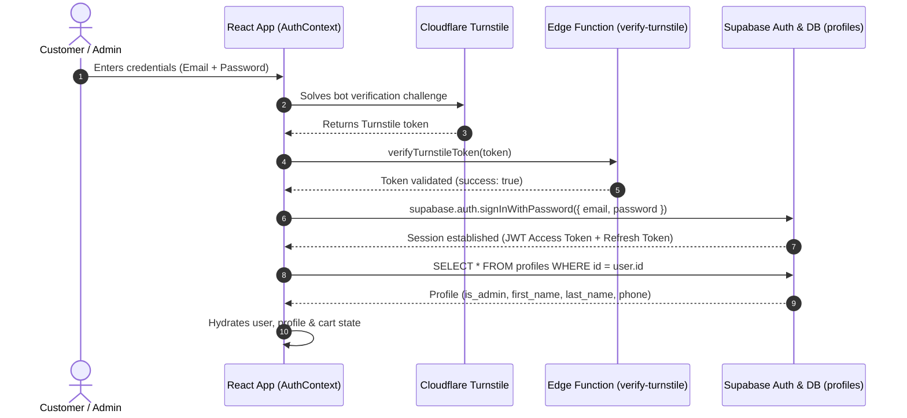
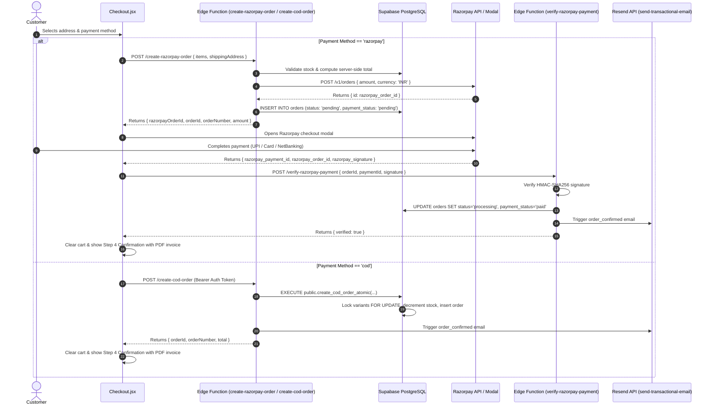

# LexCC Technical Reference & Architecture Codex
## Authoritative Functional Reference for Furniture World Ecommerce Development

**Reference Repository:** `PATILPARTH1500/8_LEXCC` (`/home/parth/Desktop/CODE PLAYGROUND/WEB DEV PROJECTS/8_LEXCC`)  
**Target Repository:** `PATILPARTH1500/9_FURNITURE_WORLD` (`/home/parth/Desktop/CODE PLAYGROUND/WEB DEV PROJECTS/9_FURNITURE_WORLD`)  
**Audited Date:** November 5, 2026  
**Purpose:** Permanent technical reference documenting the verified source code, architecture, database schemas, edge functions, security policies, and administrative workflows of the LexCC ecommerce system to guide Furniture World's backend development.

---

## 1. Project Overview

LexCC is a full-stack luxury streetwear ecommerce application engineered on React (Vite) and Supabase (PostgreSQL 15+). It features end-to-end commerce operations including customer authentication, product catalog management, persistent carts with guest-to-user merging, server-side price/stock verification, dual checkout workflows (Razorpay online payment + atomic Cash on Delivery), transactional email notifications via Resend, client-side PDF invoice generation, and an administrative dashboard.

### Core Technology Stack

| Layer | Technologies | Role in LexCC |
| :--- | :--- | :--- |
| **Frontend Framework** | React 18, Vite 5, React Router DOM v6 | Single-page application architecture |
| **State & Forms** | React Context (`AuthContext`, `CartContext`), React Hook Form, Zod | Client state, input validation & schemas |
| **Styling & Motion** | CSS Modules, Framer Motion, GSAP | Visual layout and transitions |
| **Bot / Captcha** | `@marsidev/react-turnstile` (Cloudflare Turnstile) | Bot mitigation on login and register |
| **Backend & DB** | Supabase (PostgreSQL 15), Supabase Auth, Supabase Storage | Data persistence, authentication, RLS |
| **Serverless Logic** | Supabase Edge Functions (Deno / TypeScript) | Secure order creation, payment verification, webhooks |
| **Payment Gateway** | Razorpay (Checkout JS + Orders API + Webhooks) | Indian currency (INR) payment processing |
| **Document Engine** | jsPDF, jsPDF-AutoTable | Dynamic branded PDF invoice generation |
| **Transactional Email** | Resend API (`api.resend.com/emails`) | Order confirmation and shipping dispatch notices |

---

## 2. Authentication System

### Architecture & Workflows

LexCC implements authentication via Supabase GoTrue (`@supabase/supabase-js`), wrapping the client in a centralized `AuthProvider` (`src/contexts/AuthContext.jsx`).



### Authentication Features & Verified Implementation Status

| Feature | Verified Status | LexCC Source File | Implementation Details |
| :--- | :---: | :--- | :--- |
| **Email/Password Signup** | Fully Functional | `src/contexts/AuthContext.jsx` (L156-180), `src/pages/Auth/Register.jsx` | Calls `supabase.auth.signUp()`. Passes `first_name`, `last_name`, `phone` in metadata. Trigger auto-creates profile. Handles duplicate identity detection. |
| **Email/Password Login** | Fully Functional | `src/contexts/AuthContext.jsx` (L182-201), `src/pages/Auth/Login.jsx` | Calls `supabase.auth.signInWithPassword()`. Validates credentials, sets session and triggers synchronous profile hydration. |
| **Google / Social OAuth** | **Planned But NOT Implemented** | N/A (Missing in `src/pages/Auth/Login.jsx`) | Grep confirms `signInWithOAuth` exists **only** in compiled vendor chunks and node_modules; no OAuth UI buttons or callback routes exist in LexCC source code. Must be built from scratch in Furniture World. |
| **Password Reset (Forgot)** | Fully Functional | `src/contexts/AuthContext.jsx` (L227-233), `src/pages/Auth/ForgotPassword.jsx` | Calls `supabase.auth.resetPasswordForEmail()` with `redirectTo: /reset-password`. |
| **Password Update (Reset)** | Fully Functional | `src/contexts/AuthContext.jsx` (L235-241), `src/pages/Auth/ResetPassword.jsx` | Calls `supabase.auth.updateUser({ password })`. Used when following reset email link. |
| **Password Change (Account)** | Fully Functional | `src/contexts/AuthContext.jsx` (L243-256), `src/pages/Account/Security.jsx` | Re-authenticates current password with `signInWithPassword()` before calling `updateUser()`. |
| **Phone OTP Login** | Scaffolded | `src/contexts/AuthContext.jsx` (L209-225) | `sendOTP` and `verifyOTP` functions exist, but no customer UI view is wired to phone OTP. |
| **Bot Protection** | Fully Functional | `src/pages/Auth/Login.jsx` (L25-60), `supabase/functions/verify-turnstile/index.ts` | Cloudflare Turnstile widget validates token via Supabase Edge Function using secret key. Fallback bypasses when site key is not configured in dev. |
| **Session Persistence** | Fully Functional | `src/contexts/AuthContext.jsx` (L73-115) | Listens to `supabase.auth.onAuthStateChange()`, restores active session on mount, unsubscribes on unmount. |
| **User Profile Management** | Fully Functional | `src/contexts/AuthContext.jsx` (L267-298), `src/pages/Account/Profile.jsx` | Whitelist-validated profile updates (`first_name`, `last_name`, `phone`, `dob`, `gender`, `avatar_url`). |
| **Avatar Upload** | Fully Functional | `src/contexts/AuthContext.jsx` (L300-333) | Uploads to Supabase Storage bucket `avatars` under `{userId}/{filename}`. Enforces RLS path ownership. |
| **Protected Routes** | Fully Functional | `src/components/ProtectedRoute.jsx` | Checks `user` existence and `loading` state; redirects unauthenticated visitors to `/login` with `state: { from: location }`. |
| **Admin Route Protection** | Fully Functional | `src/components/AdminRoute.jsx` | Checks `!user || !profile?.is_admin`; renders unauthorized redirect to `/` and displays animated loader during `profileLoading`. |

---

## 3. Database Architecture & Schema Codex

LexCC's database schema resides in `supabase/migrations/` (34 incremental migrations). It features strict foreign keys, cascade rules, atomic RPC functions for critical commerce paths, and comprehensive Row Level Security (RLS).

### Entity-Relationship Diagram

```mermaid
erDiagram
  PROFILES ||--o{ ADDRESSES : owns
  PROFILES ||--o| CARTS : has
  PROFILES ||--o| WISHLISTS : has
  PROFILES ||--o{ ORDERS : places
  CATEGORIES ||--o{ PRODUCTS : categorizes
  PRODUCTS ||--o{ PRODUCT_VARIANTS : has
  PRODUCTS ||--o{ PRODUCT_IMAGES : displays
  CARTS ||--o{ CART_ITEMS : contains
  PRODUCT_VARIANTS ||--o{ CART_ITEMS : references
  WISHLISTS ||--o{ WISHLIST_ITEMS : contains
  PRODUCTS ||--o{ WISHLIST_ITEMS : references
  ORDERS ||--o{ ORDER_ITEMS : contains
  PRODUCT_VARIANTS ||--o{ ORDER_ITEMS : snapshots

  PROFILES {
    uuid id PK "references auth.users(id)"
    text first_name
    text last_name
    text email
    text phone
    text avatar_url
    boolean is_admin "default false"
    timestamptz created_at
    timestamptz updated_at
  }

  CATEGORIES {
    uuid id PK
    text name
    text slug UK
    text description
    timestamptz created_at
  }

  PRODUCTS {
    uuid id PK
    text name
    text slug UK
    text description
    numeric price "check > 0"
    uuid category_id FK
    text image_url
    boolean is_featured "default false"
    boolean is_new_arrival "default false"
    text status "'active' | 'draft' | 'archived'"
    timestamptz created_at
    timestamptz updated_at
  }

  PRODUCT_VARIANTS {
    uuid id PK
    uuid product_id FK
    text size
    text color
    integer stock "check >= 0"
    timestamptz created_at
  }

  PRODUCT_IMAGES {
    uuid id PK
    uuid product_id FK
    text image_url
    integer display_order "default 0"
    timestamptz created_at
  }

  CARTS {
    uuid id PK
    uuid user_id FK "nullable for guests"
    timestamptz created_at
    timestamptz updated_at
  }

  CART_ITEMS {
    uuid id PK
    uuid cart_id FK
    uuid product_id FK
    uuid variant_id FK
    integer quantity "check > 0"
    text size
    text color
    timestamptz created_at
  }

  ADDRESSES {
    uuid id PK
    uuid user_id FK
    text first_name
    text last_name
    text street
    text address_line_2
    text city
    text state
    text postal_code "6-digit PIN code"
    text country "India"
    text phone "10/12-digit"
    text email
    boolean is_default "default false"
    timestamptz created_at
  }

  ORDERS {
    uuid id PK
    text order_number UK "e.g. LEX-17000000-ABCD"
    uuid user_id FK "nullable for guests"
    numeric total_amount
    text status "'pending' | 'processing' | 'shipped' | 'delivered' | 'cancelled'"
    text payment_method "'razorpay' | 'cod'"
    text payment_status "'pending' | 'paid' | 'failed' | 'cancelled'"
    text razorpay_order_id
    text razorpay_payment_id
    text razorpay_signature
    jsonb shipping_address
    text tracking_number
    text carrier
    boolean is_archived "default false"
    timestamptz created_at
    timestamptz updated_at
  }

  ORDER_ITEMS {
    uuid id PK
    uuid order_id FK
    uuid product_id FK
    uuid variant_id FK
    integer quantity "check > 0"
    numeric price_at_time
    timestamptz created_at
  }

  WISHLISTS {
    uuid id PK
    uuid user_id FK UK
    timestamptz created_at
  }

  WISHLIST_ITEMS {
    uuid id PK
    uuid wishlist_id FK
    uuid product_id FK
    timestamptz created_at
  }
```

### Key Database Functions & Triggers

1. **`public.is_admin()`** (`supabase/migrations/20260714000008_admin_rls_policies.sql`):
   ```sql
   CREATE OR REPLACE FUNCTION public.is_admin()
   RETURNS BOOLEAN AS $$
   BEGIN
     RETURN EXISTS (
       SELECT 1 FROM public.profiles 
       WHERE id = auth.uid() AND is_admin = TRUE
     );
   END;
   $$ LANGUAGE plpgsql SECURITY DEFINER;
   ```
   Ensures administrative security checks run in `SECURITY DEFINER` mode, preventing client-side spoofing.

2. **`public.save_admin_product_atomic(...)`** (`supabase/migrations/20260923201508_admin_product_atomic_save.sql`):
   - Accepts product metadata, variant array, and gallery image array.
   - Enforces `is_admin()` check.
   - Uses `FOR UPDATE` table locks to prevent race conditions during updates.
   - Upserts product record, updates or inserts variants, sets display orders on images.
   - Executes in a single ACID transaction.

3. **`public.create_cod_order_atomic(...)`** (`supabase/migrations/20260924011126_cod_orders_atomic.sql`):
   - Atomic RPC for Cash on Delivery checkout.
   - Locks target variants with `SELECT ... FOR UPDATE`.
   - Validates that `variant.stock >= item.quantity`.
   - Calculates server-side total amount from active database prices (ignoring browser-supplied amounts).
   - Decrements variant stock immediately.
   - Creates `orders` and `order_items` records and returns `{ order_id, order_number, total }`.

4. **`public.cancel_cod_order(...)`** (`supabase/migrations/20260924011126_cod_orders_atomic.sql`):
   - Atomically restores inventory for cancelled COD orders by incrementing variant stock.
   - Updates order status and payment status to `'cancelled'`.

5. **`public.merge_guest_cart(...)`** (`supabase/migrations/20260823000002_merge_guest_cart_fix.sql`):
   - Idempotently merges guest cart items stored in `localStorage` into the authenticated user's database cart upon login or registration.

---

## 4. Customer Features & Workflows

### 1. Cart Management (`src/contexts/CartContext.jsx`)
- Dual-mode architecture:
  - **Guest Mode:** Cart stored in browser `localStorage` under key `lexcc_cart`.
  - **Authenticated Mode:** Cart synced with Supabase tables `carts` and `cart_items`.
- Automatic guest-to-account merge on login:
  - Generates a UUID `lexcc_cart_merge_id`.
  - Calls `supabase.rpc('merge_guest_cart', { p_merge_id, p_items })`.
  - Clears `localStorage` upon successful server merge.
- Cart Drawer component (`src/components/shop/CartDrawer.jsx`) slides out with item quantities, price computations, variant sizes/colors, and direct checkout trigger.

### 2. Wishlist Management (`src/contexts/AuthContext.jsx`)
- Wishlists are database-backed (`wishlists` + `wishlist_items`).
- Provides `addToWishlist(productId)` and `removeFromWishlist(itemId)`.
- Prevents duplicates via unique constraint `(wishlist_id, product_id)`.
- Wishlist page (`src/pages/Account/Wishlist.jsx`) displays saved products with instant "Move to Bag" capability.

### 3. Customer Account Dashboard (`src/pages/Account/`)
- **Dashboard (`Dashboard.jsx`):** Displays recent orders, saved addresses count, and quick links.
- **Profile (`Profile.jsx`):** Edits first name, last name, phone, birth date, gender, and uploads avatar image.
- **Orders (`Orders.jsx`):** Paginated view of order history, status badges (`pending`, `processing`, `shipped`, `delivered`), tracking carrier info, and instant PDF invoice download button.
- **Addresses (`Addresses.jsx`):** CRUD management of shipping addresses. Enforces only one `is_default = true` address per customer.
- **Security (`Security.jsx`):** Password updates with current password verification and global session revocation.

---

## 5. Checkout & Payment Architecture

LexCC supports dual checkout options tailored for Indian ecommerce: **Razorpay Online Payments** and **Atomic Cash on Delivery (COD)**.

### Checkout Flow Diagram



### Security & Verification Guarantees

1. **Zero Browser Price Trust:** Product prices sent by the client are completely ignored. The Edge Functions query `public.products` and `public.product_variants` directly using the Supabase Service Role key, computing the exact mathematical total on the server.
2. **Atomic Stock Locking:** Variant stock is validated and decremented inside PostgreSQL transactions (`FOR UPDATE`). If two buyers purchase the last item simultaneously, the second transaction is blocked and aborted with an out-of-stock exception.
3. **Cryptographic Payment Verification:** Razorpay returns an HMAC-SHA256 signature calculated over `${razorpay_order_id}|${razorpay_payment_id}` using the merchant secret. The verification function validates this signature using timing-safe comparison (`secureEqual`) before marking any order as paid.
4. **Idempotent Webhooks:** `supabase/functions/razorpay-webhook/index.ts` handles asynchronous callbacks from Razorpay (e.g. network drops before the frontend receives confirmation) and idempotently transitions the order state.

---

## 6. Admin Dashboard Architecture

The administrative control panel is located under `/account/admin` and protected by `AdminRoute.jsx` and PostgreSQL RLS policies.

### Admin Navigation & Capabilities

| View | Route | LexCC Source Component | Admin Capabilities |
| :--- | :--- | :--- | :--- |
| **System Overview** | `/account/admin` | `src/pages/Admin/AdminDashboard.jsx` | Real-time aggregated metrics: Total Revenue (INR), Total Orders, Active Products, Low Stock count, and Recent Orders feed. |
| **Products List** | `/account/admin/products` | `src/pages/Admin/AdminProducts.jsx` | Searchable product table, category filters, status toggle (`active`/`archived`), stock indicators, edit links, and direct delete actions. |
| **Product Form (New/Edit)** | `/account/admin/products/new`<br/>`/account/admin/products/:id/edit` | `src/pages/Admin/AdminProductForm.jsx` | Full product authoring: name, description, price, category, gallery images (up to 8, max 5MB, JPG/PNG/WebP), variant matrix (size, color, stock), and atomic saving via RPC. |
| **Orders Management** | `/account/admin/orders` | `src/pages/Admin/AdminOrders.jsx` | Searchable order table, status filtering, order lifecycle transitions (`pending` $\rightarrow$ `processing` $\rightarrow$ `shipped` $\rightarrow$ `delivered`), COD cancellation with stock restoration, tracking modal (carrier + tracking number), and admin PDF invoice generation. |
| **Customer Directory** | `/account/admin/customers` | `src/pages/Admin/AdminCustomers.jsx` | Customer list with joined order metrics: total orders placed, lifetime spend (INR), email, and join date. |

---

## 7. Supabase Storage, Edge Functions & External Integrations

### Supabase Storage Buckets

1. **`product-images` (Public):**
   - Path structure: `products/{productId}/{timestamp}-{uuid}.{ext}`
   - RLS: Public read access; write/delete restricted to admins via `public.is_admin()`.
2. **`avatars` (Public):**
   - Path structure: `{userId}/{timestamp}-{uuid}.{ext}`
   - RLS: Public read access; insert/update restricted to the authenticated owner (`auth.uid() = storage.foldername(name)[1]`).

### Edge Functions Inventory

| Edge Function | Runtime | Purpose | External API Dependencies |
| :--- | :---: | :--- | :--- |
| **`create-razorpay-order`** | Deno | Server-side validation of cart & creation of Razorpay order | Razorpay Orders API (`api.razorpay.com/v1/orders`) |
| **`verify-razorpay-payment`** | Deno | HMAC-SHA256 signature verification and order state transition | None (Cryptographic Web SubtleCrypto) |
| **`razorpay-webhook`** | Deno | Webhook listener for asynchronous payment settlement | Razorpay Webhook Signature |
| **`create-cod-order`** | Deno | Authenticated COD order placement via atomic RPC | None |
| **`send-transactional-email`** | Deno | Dispatches HTML emails for order confirmation & dispatch | Resend API (`api.resend.com/emails`) |
| **`verify-turnstile`** | Deno | Validates Cloudflare Turnstile captcha tokens | Cloudflare Turnstile API |
| **`get-order-invoice`** | Deno | Authorization-aware order data fetcher for PDF invoices | None |

### Required Environment Variables

```env
# Client Frontend (.env / .env.local)
VITE_SUPABASE_URL=https://your-project.supabase.co
VITE_SUPABASE_ANON_KEY=your-anon-key
VITE_RAZORPAY_KEY_ID=rzp_test_or_live_key
VITE_CLOUDFLARE_TURNSTILE_SITE_KEY=your-turnstile-site-key

# Serverless Edge Functions (Configured in Supabase Vault / Secrets)
SUPABASE_URL=https://your-project.supabase.co
SUPABASE_SERVICE_ROLE_KEY=your-service-role-key  # NEVER expose in frontend
RAZORPAY_KEY_ID=rzp_test_or_live_key
RAZORPAY_KEY_SECRET=your-razorpay-secret         # NEVER expose in frontend
RESEND_API_KEY=re_your_resend_api_key           # NEVER expose in frontend
CLOUDFLARE_TURNSTILE_SECRET_KEY=your-secret      # NEVER expose in frontend
```

---

## 8. Feature Implementation Status Matrix

| Feature | Verified Status | LexCC Source Files | Dependencies | Furniture World Action |
| :--- | :---: | :--- | :--- | :--- |
| **Email/Password Auth** | **Fully Functional** | `AuthContext.jsx`, `Login.jsx`, `Register.jsx` | Supabase Auth, Zod | **Reuse & Adapt:** Migrate to Furniture World with brand styling. |
| **Google OAuth** | **Planned / Not Implemented** | Missing in LexCC | Google Cloud Console, Supabase GoTrue | **Build New:** Implement `signInWithOAuth({ provider: 'google' })`. |
| **Customer Profiles** | **Fully Functional** | `AuthContext.jsx`, `Profile.jsx` | Supabase `profiles` table | **Adapt:** Align with Furniture World's `role` column (`customer`/`admin`). |
| **Customer Addresses** | **Fully Functional** | `AuthContext.jsx`, `Addresses.jsx` | Supabase `addresses` table | **Reuse:** Indian address schema with 6-digit PIN code validation. |
| **Persistent Cart** | **Fully Functional** | `CartContext.jsx`, `CartDrawer.jsx` | `carts`, `cart_items`, RPC `merge_guest_cart` | **Adapt:** Bridge existing Zustand cart with Supabase DB persistence. |
| **Wishlist** | **Fully Functional** | `AuthContext.jsx`, `Wishlist.jsx` | `wishlists`, `wishlist_items` | **Reuse & Adapt:** Implement dedicated Furniture World Wishlist drawer & page. |
| **Product Variants** | **Fully Functional** | `AdminProductForm.jsx`, `ProductDetail.jsx` | `products`, `product_variants` | **Adapt:** LexCC uses apparel sizes/colors; Furniture World uses timber finishes & upholstery fabrics. |
| **Admin Dashboard** | **Fully Functional** | `AdminDashboard.jsx`, `AdminRoute.jsx` | `is_admin()`, Supabase RLS | **Reuse & Elevate:** Adapt to Furniture World typography, palette, and metrics. |
| **Admin Product Form** | **Fully Functional** | `AdminProductForm.jsx` | RPC `save_admin_product_atomic`, Storage | **Adapt:** Update variant schema for furniture dimensions, wood finishes, fabrics. |
| **Admin Order Management** | **Fully Functional** | `AdminOrders.jsx` | `orders`, `order_items`, tracking modal | **Reuse:** Exact order lifecycle and tracking carrier modal works directly. |
| **Admin Customer List** | **Fully Functional** | `AdminCustomers.jsx` | `profiles`, `orders` aggregation | **Reuse:** Direct reuse with Furniture World styling. |
| **Razorpay Online Checkout** | **Fully Functional** | `Checkout.jsx`, `PaymentProvider.js`, Edge Functions | Razorpay API, HMAC-SHA256 verification | **Reuse & Adapt:** Retain robust server-side validation; update branding for Furniture World. |
| **Atomic Cash on Delivery** | **Fully Functional** | `Checkout.jsx`, `create_cod_order_atomic` | PostgreSQL RPC, transaction locks | **Reuse:** Direct reuse of atomic stock decrementing RPC. |
| **PDF Invoice Generator** | **Fully Functional** | `src/utils/invoiceGenerator.js` | jsPDF, jsPDF-AutoTable | **Reuse & Rebrand:** Replace LexCC header with Furniture World letterhead & GSTIN. |
| **Transactional Email** | **Implemented (Needs Config)** | `supabase/functions/send-transactional-email` | Resend API key | **Reuse & Rebrand:** Replace LexCC dark theme with Furniture World warm cream template. |
| **Turnstile Captcha** | **Implemented (Needs Config)** | `Login.jsx`, `verify-turnstile` | Cloudflare Turnstile key | **Optional:** Evaluate if needed or rely on Supabase native rate-limiting. |

---

## 9. Furniture World Integration Recommendations

### 1. Schema Reconciliation (LexCC vs Furniture World)

Furniture World already possesses a starter migration (`supabase/migrations/20240101000000_initial_schema.sql`). We must merge LexCC's battle-tested features into this schema without creating duplicate tables:

| Entity | LexCC Pattern | Furniture World Starter | Recommended Synthesis for Furniture World |
| :--- | :--- | :--- | :--- |
| **User Roles** | `is_admin BOOLEAN` | `role TEXT ('customer', 'admin', 'concierge')` | **Keep Furniture World's `role` column.** Define `public.is_admin() := (role = 'admin')`. Provides clean extensible RBAC. |
| **Product Variants** | `size TEXT, color TEXT, stock INT` | `finish_name, wood_finish_id, fabric_finish_id, sku, in_stock` | **Extend Variant Model:** Add `stock INT` to Furniture World variants, and keep `wood_finish_id` / `fabric_finish_id` for furniture customization. |
| **Orders** | Integrated columns (`razorpay_order_id`, `payment_status`, `carrier`) | Separate `payments` table | **Harmonize:** Store `razorpay_order_id`, `payment_method`, `payment_status`, `tracking_number`, `carrier` on `orders` for fast queries, while logging audit events in `payments`. |
| **Inventory** | Direct `stock` column on `product_variants` | Separate `inventory` table with `quantity_available` | **Synchronize:** Keep `inventory` table for advanced warehouse tracking, or add a generated column / sync trigger with `product_variants.stock`. |

### 2. State Management Adaptation (Zustand + Supabase)

- LexCC uses React Context (`CartContext.jsx`).
- Furniture World currently uses Zustand (`src/store/useCartStore.ts`).
- **Recommendation:** Keep Zustand as the frontend state store for ultra-fast UI rendering and cart drawer operations, and add a Supabase synchronization middleware that persists items to `public.carts` and `public.cart_items` when an authenticated user is logged in.

### 3. Google OAuth Setup Requirements

To satisfy the user's requirement for Google OAuth (starting tomorrow):
1. Create OAuth 2.0 Client Credentials in Google Cloud Console.
2. Configure Authorized JavaScript origins: `http://localhost:3000`, `https://9-furniture-world.vercel.app`.
3. Configure Authorized redirect URI: `https://<supabase-project-id>.supabase.co/auth/v1/callback`.
4. Enable Google provider in Supabase Dashboard $\rightarrow$ Authentication $\rightarrow$ Providers.
5. In Furniture World, invoke:
   ```ts
   await supabase.auth.signInWithOAuth({
     provider: 'google',
     options: {
       redirectTo: `${window.location.origin}/account`,
     },
   });
   ```

---

## 10. Document Verification & Sign-Off

This document accurately reflects the live code in `8_LEXCC`. It is free of fictitious descriptions, records verified limitations (such as the absence of client-side Google OAuth in LexCC), and establishes the definitive technical blueprint for Furniture World's backend implementation.

